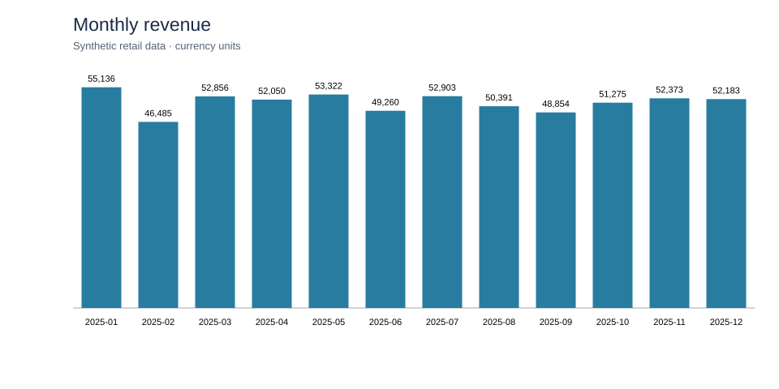
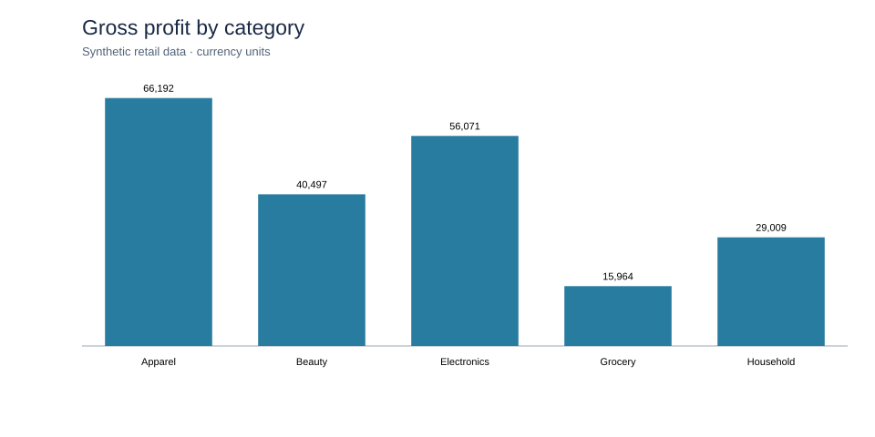

# Findings from the synthetic dataset

These observations were calculated from the supplied synthetic raw data after the documented cleaning rules. They do **not** describe a real business.

## Observations

- Accepted 2025 sales generated **617,088.63** currency units of revenue and **207,733.04** of gross profit (about **33.66%** gross margin). Monthly results are in `outputs/01_monthly_store_category.csv`.
- The highest revenue month was **January (55,135.55)**. Market had the highest store revenue (**207,088.91**), while Harbor had the highest gross profit (**69,997.76**). Apparel had the highest category revenue (**194,629.54**) and gross profit (**66,191.83**).
- Under the defined top-quartile sales and under-15% margin screen, **P011, Grocery item 11**, was the one high-sales/low-margin product: **379 units** and **8.28%** gross margin. This is a screen for investigation, not evidence of a pricing mistake.
- The slow-mover screen identified **51 store-product pairs** with at least 50 units on hand and fewer than 0.5 units sold per day over the latest 28-day window. For example, Market had **161 units** of P013 and sold **5** in that window.
- The replenishment query flagged **9 store-product pairs** at the 2025-12-28 snapshot. The largest calculated shortfall was **10 units** for P034 at Park (2 on hand versus a 12-unit reorder point).

## Assumptions and possible actions

The replenishment example uses a 28-day trailing demand average, 14-day supplier lead time, seven-day review period, and seven demand-days of safety stock. Together these imply 28 days of cover. A flagged row could prompt a stock check and review of open orders, supplier lead time, and upcoming promotions. P011 could prompt a price and cost review. Slow movers could prompt a review of order quantities and shelf space. None of these screens alone justifies a purchase or price change.

## Limits

Sales and inventory are generated independently, so the snapshots do not reconcile to receipts and sales. Demand is noisy, the latest snapshot precedes year-end, and no returns, discounts, taxes, stockouts, supplier constraints, or operating expenses are modeled. Currency is deliberately unspecified. The charts and thresholds illustrate analysis methods rather than business performance.
